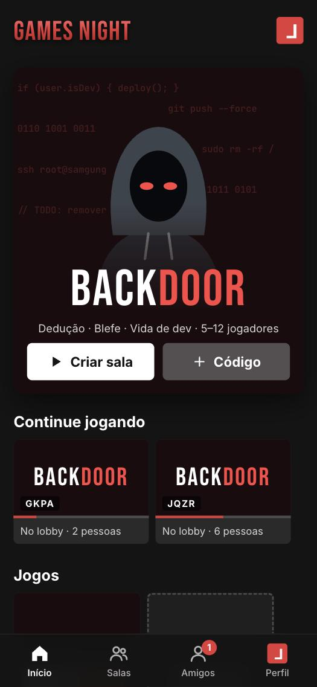
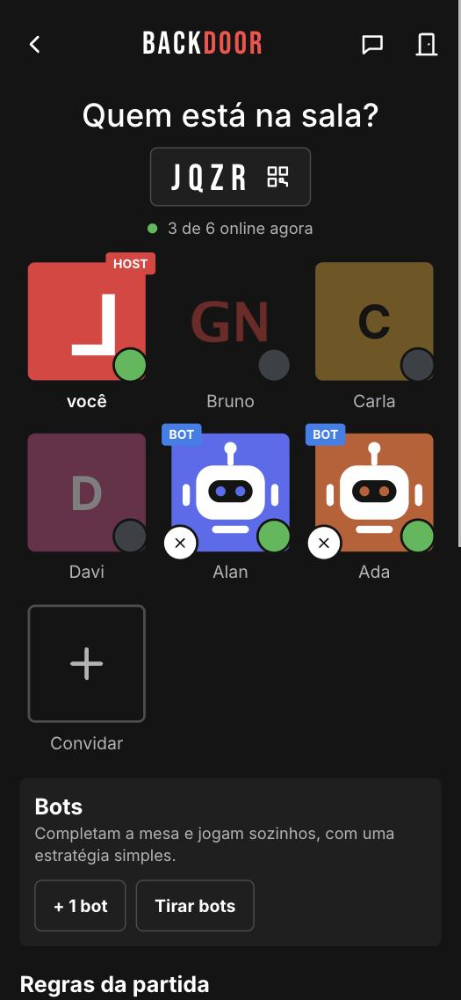
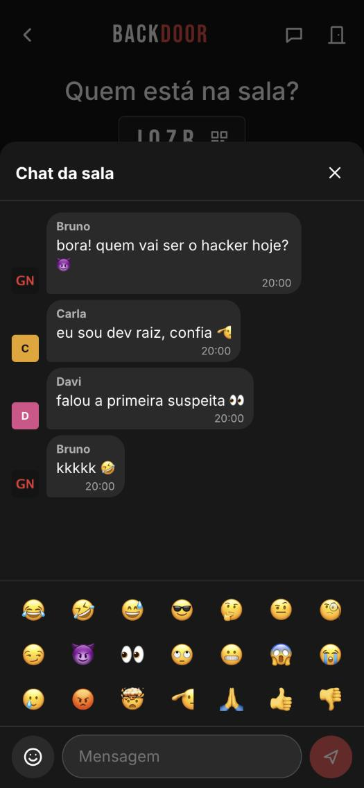
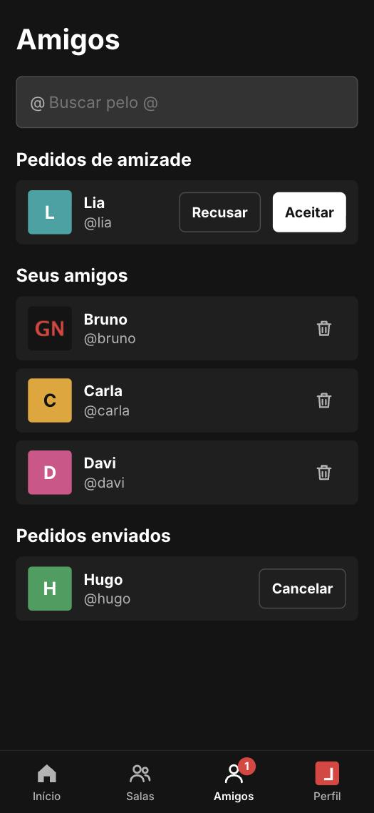
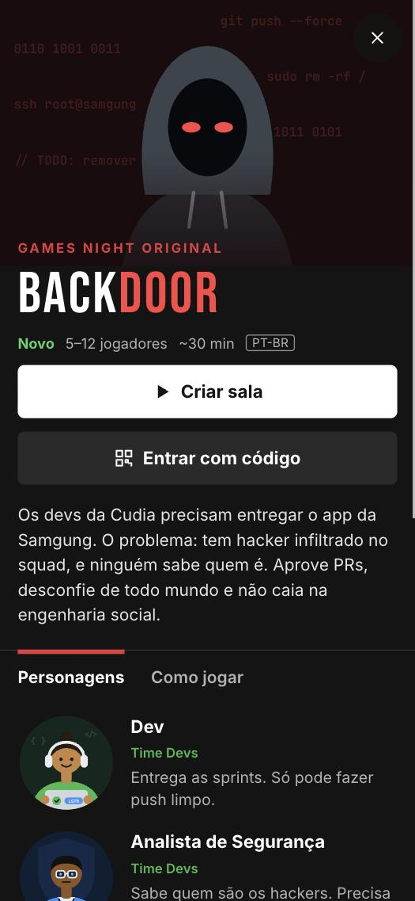
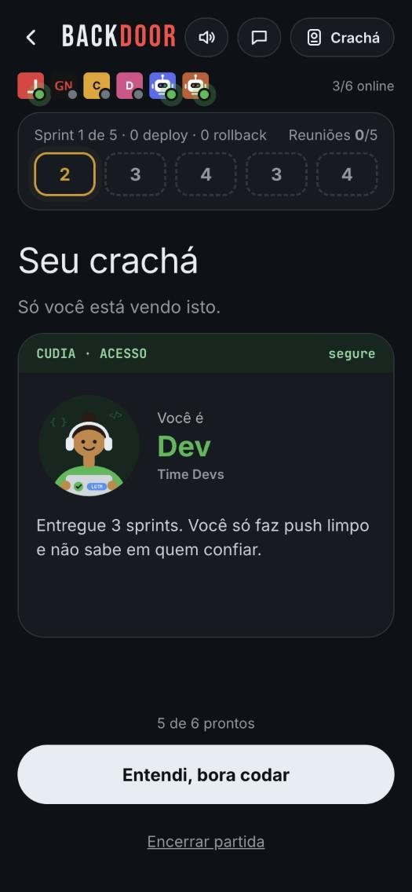
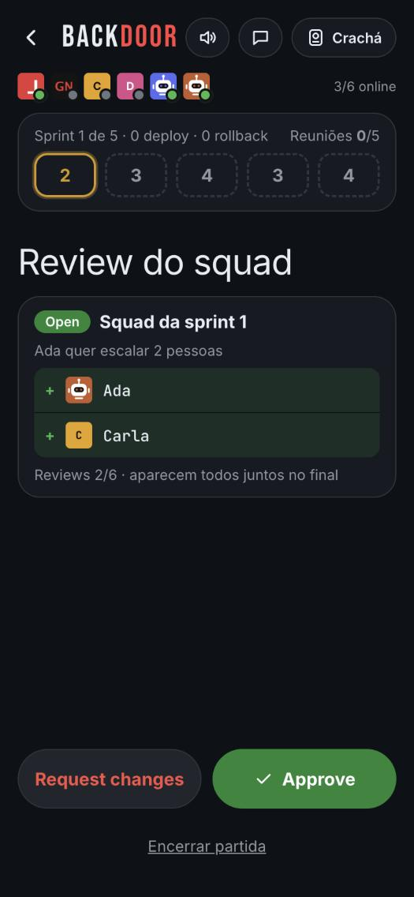
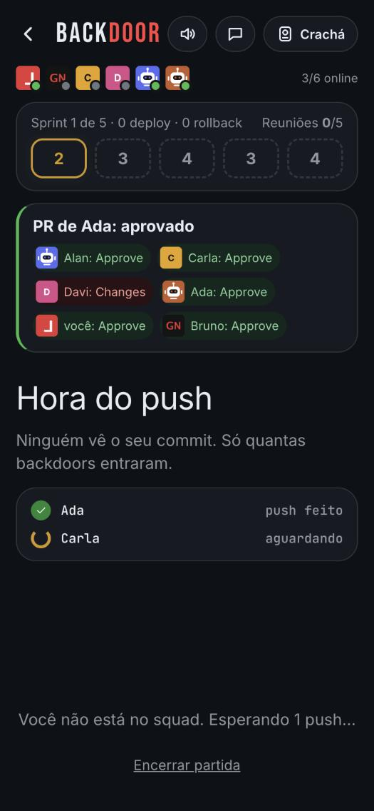
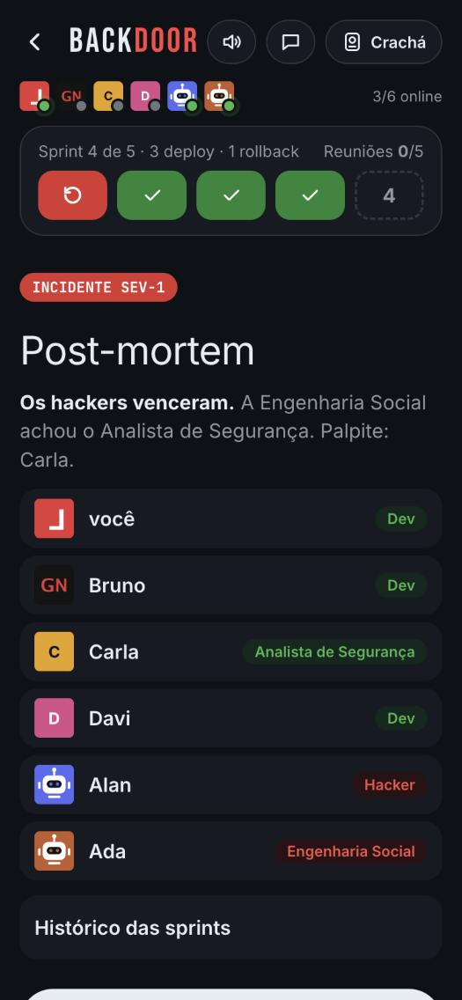

# Games Night

A hub of party games to play with friends, each person on their own phone. Someone creates a room, the others join with a 4-letter code or a QR code, and the game runs live on everyone's screen.

Live at **https://gamesnight.nelsul.com**. Mobile first (Safari and Chrome), dark only. The site's interface is in Brazilian Portuguese; code and docs are in English.

## The hub

<table>
  <tr>
    <td></td>
    <td></td>
    <td></td>
  </tr>
  <tr>
    <td align="center"><b>Início</b> Featured game and rooms to continue</td>
    <td align="center"><b>Sala</b> Code, QR, invites, bots and who's online</td>
    <td align="center"><b>Chat</b> In the lobby and during matches</td>
  </tr>
  <tr>
    <td></td>
    <td></td>
    <td></td>
  </tr>
  <tr>
    <td align="center"><b>Amigos</b> Find people by @ and add them</td>
    <td align="center"><b>Página do jogo</b> Synopsis, characters and rules</td>
    <td></td>
  </tr>
</table>

## Backdoor

<table>
  <tr>
    <td></td>
    <td></td>
    <td></td>
  </tr>
  <tr>
    <td align="center"><b>Crachá</b> Your secret role, while you hold it</td>
    <td align="center"><b>Review</b> The Scrum Master's squad as a PR</td>
    <td align="center"><b>Push</b> Votes revealed, then a secret push</td>
  </tr>
  <tr>
    <td></td>
    <td></td>
    <td></td>
  </tr>
  <tr>
    <td align="center"><b>Post-mortem</b> Who won and every badge</td>
    <td></td>
    <td></td>
  </tr>
</table>

Screenshots at iPhone size from a local copy with test people and bots.

## Games

| Game | Status | What it is |
|---|---|---|
| **Backdoor** | playable | Social deduction for 5–12 people. The devs at Cudia ship sprints for their client Samgung while hidden hackers in the squad try to slip in a backdoor. The Scrum Master proposes squads like pull requests, everyone reviews them, and each sprint is pushed in secret: Deploy or Rollback. Optional roles: Product Owner, Zero-day, Freelancer. |

More games will plug into the same hub: rooms, lobby, profiles and live updates are shared; each game brings its own rules and look.

## What's here today

- Sign in with a code sent by email (no passwords)
- Profile with a name, a unique @handle and a photo
- Friends: search people by @, send and answer friend requests
- Create a room for a game; friends join by invite, code, link or QR code
- Live notifications of friend requests and room invites
- Room chat, in the lobby and during matches
- Live lobby: who is in the room and who is online, updated over a WebSocket
- **Backdoor**, playable end to end: secret badges, live squad picking, open reviews, secret pushes, the Social Engineer's last guess, post-mortem, and play again

## Stack

| Part | Stack |
|---|---|
| `api/` | Go (chi, pgx, coder/websocket). JSON API under `/api`, WebSocket per room, and it serves the built web app |
| `web/` | SvelteKit 2 static SPA, Svelte 5, TypeScript |
| Database | PostgreSQL 17, migrations embedded in the API (`api/migrations/`), applied on start |
| Photos | Cloudflare R2 (S3 API), private objects with presigned URLs |
| Email | SMTP (login codes only) |
| Hosting | Docker Compose on a VPS behind nginx; every merge into `main` deploys |

## Develop

See [CONTRIBUTING.md](CONTRIBUTING.md) for running it locally and how changes ship. AI agents: see [AGENTS.md](AGENTS.md).
